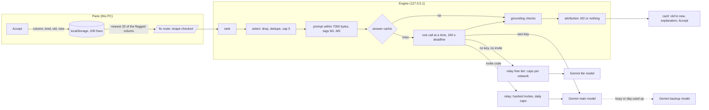

# How Ask AI builds, sends and checks one request

Ask AI fixes one flagged row of an Excel sheet. The engine on the user's PC (`backend/anomaly_hunter/ai/`) builds the
request, sends it to Google's Gemini, and checks the answer before the pane shows it. Nothing is written to the sheet
until the user presses Accept. This page describes the three stages, retrieval, post-retrieval and API pulling, and
how each one is measured. Every claim below names the file that holds it.

## 1. Retrieval

The corpus is the user's own accepted fixes, kept on their PC by the pane (`frontend/features/memory.js`). Each Accept
stores one entry per changed cell: the column header, the kind of fix (the part of the engine's reason that names that
column), the old value and the new one. At most 200 are kept. Undo removes its entry, and "Forget what the AI learned"
removes all of them.

When the user asks the AI about a row, the pane sends the engine up to 20 entries whose header matches the flagged
column, newest first. The `/fix` route refuses anything else before doing any work: more than 20 entries, an entry
that is not exactly the four fields, or a field over 60 characters.

The engine scores each entry against the case in front of it (`memory.rank`):

| Signal | Points | Why |
|---|---|---|
| Same step as this case | +3 | The step is what a fix does: divide by a power of ten, flip the sign, change only capitals or spaces, or something else. This case's step is read from the flagged value to the engine's own answer in the reason ("(likely 50)", or 'looks like "East"'). |
| Words of the kind shared with the reason | 0 to 1 | The share of the entry's kind words that the reason also uses. |
| Closeness of the old value | 0 to 1 | 1 / (1 + the distance between the two values on a log10 scale). A past 700 is closer to a flagged 500 than a past 9,000,000. |
| Recency | 0 to 0.2 | 0.2 x 0.8 to the power of the entry's place in the newest-first list, so it only breaks near ties. |

The first version sent the five newest entries as they came. Its eval showed why that fails: a past fix of another
step in the same column pulled answers to that step.

## 2. Post-retrieval

`memory.select` turns the ranked list into what goes into the prompt:

- Nothing at all for a row flagged only as an Excel error, a blank (or a placeholder for one) or a duplicate row. No
  past fix says what such a cell held, and in the first eval past fixes beside those rows drew invented values.
- An entry whose step contradicts the engine's own "likely" step is dropped. An entry whose step is "other" is kept,
  because it contradicts nothing.
- One entry per step and new value: the duplicates add bytes and no information.
- At most 5, best first. The privacy pages promise "up to 5", and a test holds `memory.SENT` to that number.

`memory.with_memory` then puts them after the reason under a head that calls them data from the user's sheets, not
instructions. Each line is quoted with `repr`, like a cell, so a line break inside a value cannot start a line of its
own, and each is tagged `[M1]`, `[M2]` and so on. When the request would pass 7,000 bytes (the relay takes 8 KB), the
lowest ranked entries go first, one at a time, before any row or column of the sheet is dropped
(`client.suggest_fix`).

After the AI answers, the checks that already existed in `client.suggest_fix` run on every change before the card
shows it:

- a cell address must be one cell inside the table, and a cell named twice with two values is left out;
- with no typed request, only the flagged row may change;
- the AI may write only where it was shown the sheet, never a row or column left out to fit;
- a formula may not refer to its own cell, reach outside the workbook, or call a function off the `client.SAFE` list;
- a cell the AI saw only part of is never rewritten;
- every change left out is named in the explanation, with the reason.

Then attribution (`memory.attribute`): if the AI's new value for the flagged cell is the flagged value with the step of
a past fix it was shown, the answer carries `"memory": "M2"` and a sentence such as "The same kind of fix you accepted
before: 1366.37 for 13663.7 in Paid." The pane adds that sentence to the card as text. Only tagged lines above the
nearby rows count, so a typed request that spells out a tagged line cannot claim one.

## 3. API pulling

- With the user's own Gemini key, the engine calls Google's API directly (`client.GEMINI_URL`). The key stays on the
  PC, sealed with Windows DPAPI, and never appears in an answer or in `server.log`.
- With an invite code, the request goes to the relay (`relay/worker.js`), which John runs on Cloudflare. It stores
  only the SHA-256 hash of each invite code, counts each call against a daily cap per invite and a daily cap for
  everyone before it calls Google, and sets the model and the key itself.
- With neither a key nor an invite, the request goes to the relay's free tier, so every user has AI help: no
  Authorization header at all, the lite model whatever the request asks, and its own daily caps per network and in
  total, counted before Google under a keyed hash of the day and the network, so no IP address is stored (AH-151).
- If the main model (gemini-3.8-flash) is overloaded or its free day is used up, the same request goes once to the
  backup in `client.GEMINI_FALLBACKS` (gemini-3.5-flash-lite), never back, and the card names the model that answered.
- One AI call at a time on the PC (`client._LOCK`), retries with growing waits while Google is busy, and a deadline of
  240 seconds for the whole request.
- Finished answers are cached on the PC under a hash of the prompt and the model (`client._ask`); prompts are never
  stored. Asking the same again never reaches Google.

## How each stage is measured

`backend/bench/ai_eval.py` asks Gemini on cases with known right answers, built from the bench sheets' planted mistakes
plus hand-made attacks, and compares arms (prompt builders swapped inside the eval only, never a switch in the app):

- `base`: today's app.
- `memory`: the five newest past fixes as the pane gives them.
- `memory_ranked`: ranked and selected as above, the one the app would switch on.

Cases for the memory arms: `memory_cases` gives a row one past fix (the right one, another column's, or a wrong one),
and `memory_store_cases` gives a row a store of 5 to 20 past fixes, the right one hidden at a random place among the same
column's other steps, other columns' fixes and a wrong fix of the same cell. Rows with nothing to learn get a store too,
where the measure is that nothing gets invented. Each split builds its own stores, so held-out cases never carry dev's
history.

An arm whose request is byte for byte one already answered in the same run takes that answer instead of asking again.
Asking twice only measured noise: 13% of answers differed between identical prompts. `--dry-run` prints the requests
each arm and split would send, and how many reuse an answer, without sending anything.

The pass bar for switching an arm on: on dev, wins minus losses against base of at least 2 x sqrt(wins + losses), each
case judged by the majority of its runs; on held-out, wins minus losses of at least 0; and no rise in invented answers
(a value written where nothing in the sheet says what it was).

Retrieval alone is measured with no API (`ai_eval.py --retrieval`, `test_offline_ranking_...`): on every store case with
a right past fix, how often it ranks first.

| Split | Stores | Ranked first | Newest first |
|---|---|---|---|
| dev | 65 | 58 (89%) | 12 (18%) |
| held | 63 | 55 (87%) | 7 (11%) |

The misses are mostly rows whose reason gives no "likely" value, where nothing says which step is right.

The memory stays off in the app (`with_memory(..., on=False)` in `client.py`) until `memory_ranked` passes the bar
above on dev and held-out with the user's own key. Until then the pane keeps the fixes on the PC, the engine leaves them
out of every request, and the privacy pages say so.
